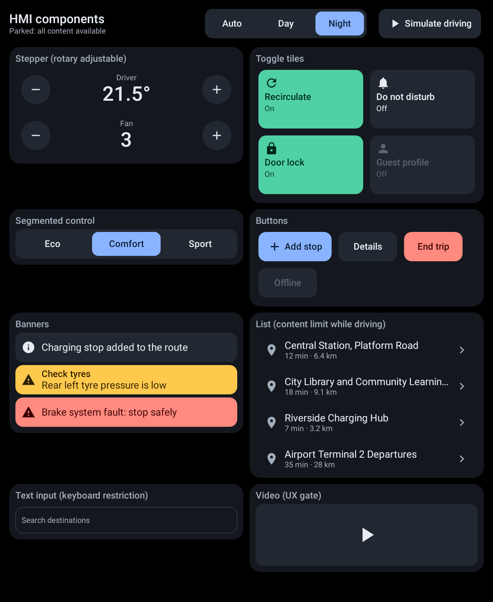
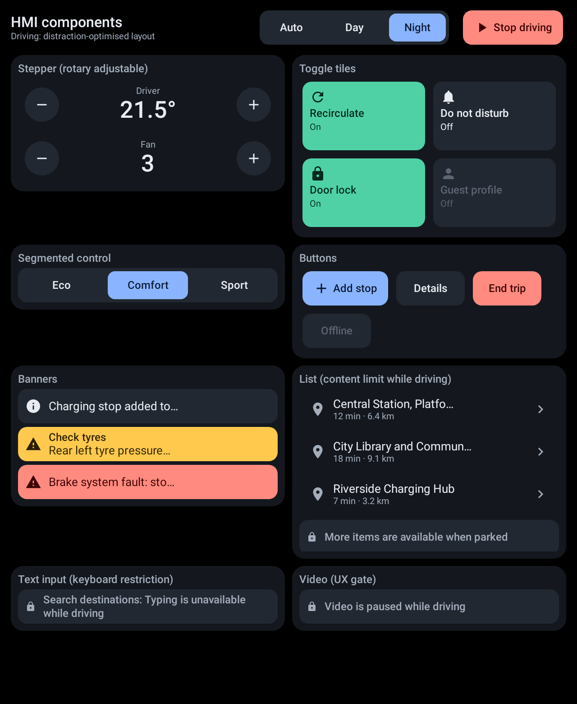
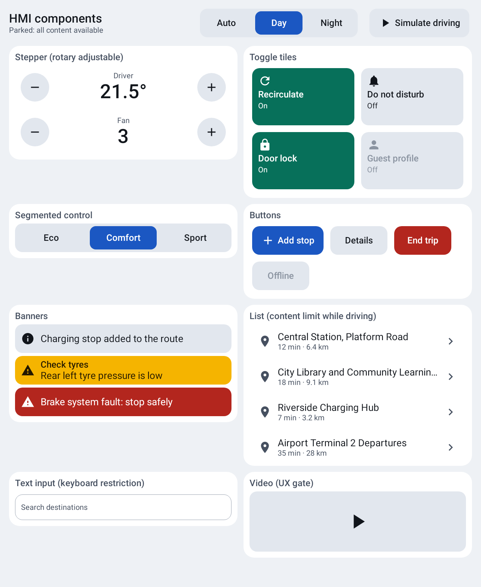
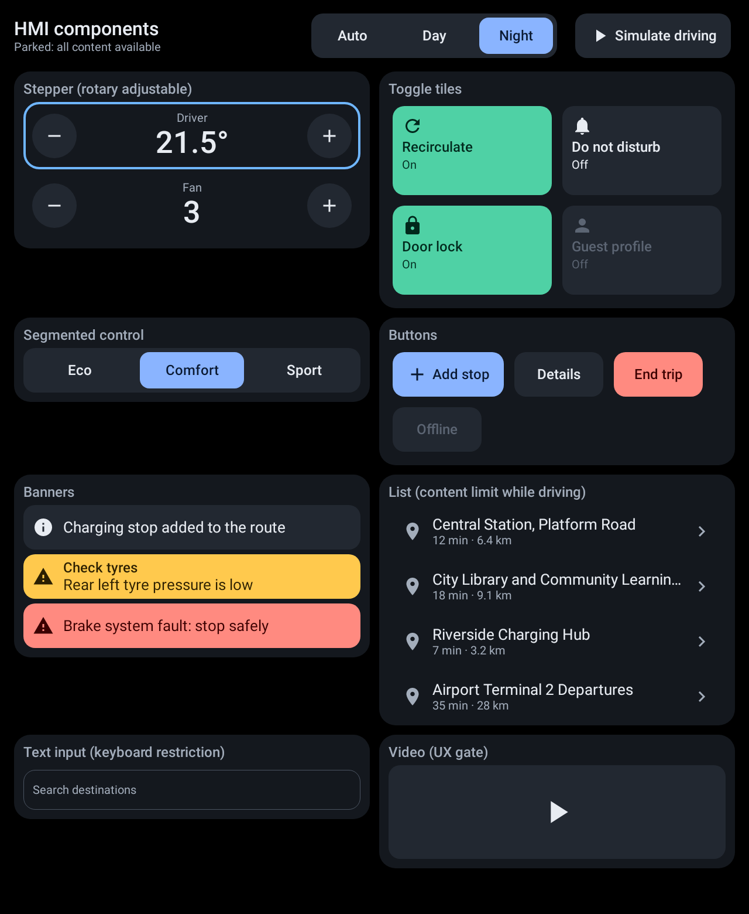
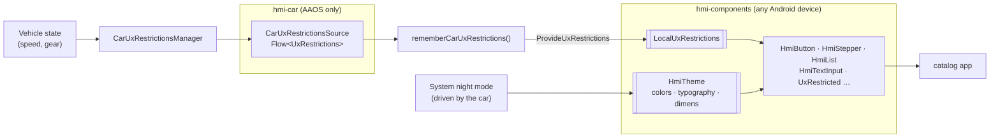

# AAOS HMI Components: a Compose kit for in-vehicle UIs


[](https://jitpack.io/#namdevlondhe/aaos-hmi-components)


Jetpack Compose components for **Android Automotive OS** that handle the parts generic UI kits leave out:

- **Driver-distraction rules built in.** Every component reads the current `CarUxRestrictions` and adapts by itself:
  long text is shortened, lists are cut to the allowed length, the keyboard and video give way to a notice
- **Rotary and D-pad ready.** A visible focus ring on every control, and steppers you adjust by turning the knob
- **Day/night theme** that follows the vehicle's light sensor, with **contrast ratios checked by unit tests**
- **76dp touch targets** (the AAOS minimum) and type that never drops below 24sp for body text
- A **catalog app** to browse everything, and **JitPack** publishing

| Parked, night | Driving (same screen, restrictions applied) |
|---|---|
|  |  |

| Day | Rotary focus on the temperature stepper |
|---|---|
|  |  |

*These screenshots are rendered by the unit tests on the JVM ([Roborazzi](https://github.com/takahirom/roborazzi) +
Robolectric), not taken from an emulator, so they always show the current code.*

## Components

| Component | What makes it automotive |
|---|---|
| `HmiButton` | 76dp min height, primary/secondary/critical styles, focus ring |
| `HmiToggleTile` | Large on/off tile; state shown by colour **and** text; `Role.Switch` |
| `HmiStepper` | One focus stop; D-pad left/right or rotary scroll changes the value; the value never wraps |
| `HmiSegmentedControl` | Mutually exclusive options (drive mode), radio-button semantics |
| `HmiListItem` / `HmiList` | Text shortened to `maxStringLength`; list cut to `maxContentItems` with a "more when parked" notice |
| `HmiBanner` | Info/warning/critical; announced by TalkBack (assertively for critical) |
| `HmiTextInput` | Turns into a notice when the keyboard is restricted, so no screen can open a keyboard while moving |
| `UxRestricted` | Generic gate: `UxRestricted({ it.noVideo }, "Video is paused while driving") { Player() }` |
| `HmiTheme` | Day/night tokens (colours, type, sizes) plus a matching Material 3 theme |

## Architecture



- **`hmi-components`** has no Car API dependency (minSdk 24). `UxRestrictions` is a plain data class, so screens
  can be built and tested on a phone or the JVM.
- **`hmi-car`** is a thin adapter: it maps `CarUxRestrictions` flags to `UxRestrictions` and exposes them as Compose
  state. On a device without `FEATURE_AUTOMOTIVE` it returns the fallback and never touches a Car API class, so one
  APK runs on both.

## Use it

```kotlin
// settings.gradle.kts
dependencyResolutionManagement { repositories { maven("https://jitpack.io") } }

// build.gradle.kts
dependencies {
    implementation("com.github.namdevlondhe.aaos-hmi-components:hmi-components:<tag>")
    implementation("com.github.namdevlondhe.aaos-hmi-components:hmi-car:<tag>") // AAOS apps only
}
android { useLibrary("android.car") } // only when you use hmi-car
```

```kotlin
setContent {
    val restrictions by rememberCarUxRestrictions()           // from the vehicle; unrestricted elsewhere
    HmiTheme {                                                 // follows the car's day/night mode
        ProvideUxRestrictions(restrictions) {
            HmiStepper(
                value = "%.1f°".format(temperature),
                label = "Driver",
                onDecrement = { viewModel.step(-1) },
                onIncrement = { viewModel.step(+1) },
            )
            HmiList(destinations) { HmiListItem(it.name, supportingText = it.eta, onClick = { open(it) }) }
        }
    }
}
```

Mark activities that are safe while driving with
`<meta-data android:name="distractionOptimized" android:value="true"/>`, as the catalog does.

## Run it

Requires JDK 17 and the Android SDK (platform 35).

```bash
./gradlew :catalog:assembleDebug
```

On an **Android Automotive emulator** (Android Studio → Device Manager → Automotive system image):

```bash
./gradlew :catalog:installDebug
```

The catalog reads the real driving state. In the emulator's *Extended controls → Car data*, put the gear in
*Drive* and set a speed to watch the restrictions apply. On a phone, or while parked, the **Simulate driving**
button applies the same restrictions.

## Tests

```bash
./gradlew detekt testDebugUnitTest
./gradlew :catalog:recordRoborazziDebug   # re-render docs/screenshots
```

31 JVM tests, no emulator needed:

- **`ContrastTest`** checks every text/background pair in both palettes against WCAG 4.5:1, and the focus ring
  against 3:1 (non-text contrast)
- **`ComponentsTest`** (Compose UI tests on Robolectric): touch-target size, roles and states for TalkBack,
  stepper changed by **D-pad key events** once focused, list limits, text shortening, keyboard and video gates
- **`UxRestrictionsTest`** and **`UxRestrictionsMappingTest`**: limits, and the mapping from the Car API flags
- **`CatalogTest`** drives the real `CatalogApp` (including `hmi-car`'s non-automotive fallback) through
  "Simulate driving"
- **`CatalogScreenshotTest`** renders the screenshots above

## Project layout

```text
hmi-components/   theme/ (tokens, HmiTheme)  ux/ (UxRestrictions)  focus/ (focus ring, rotary)  components/
hmi-car/          CarUxRestrictionsSource, rememberCarUxRestrictions (Car API adapter)
catalog/          demo app (AAOS + phone), Robolectric and screenshot tests
docs/screenshots/ rendered by CatalogScreenshotTest
```

## License

[MIT](LICENSE) © Namdev Londhe
